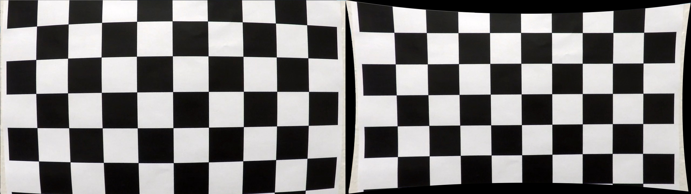
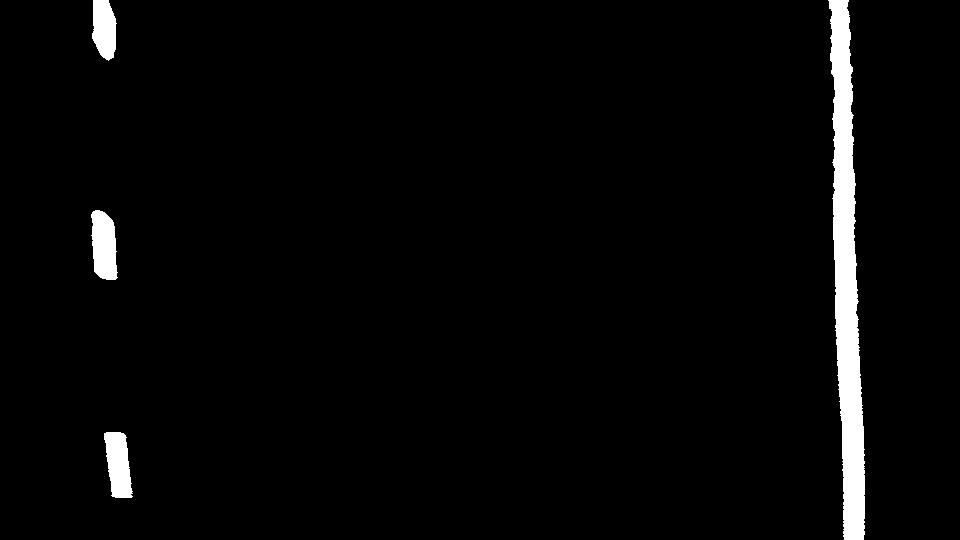
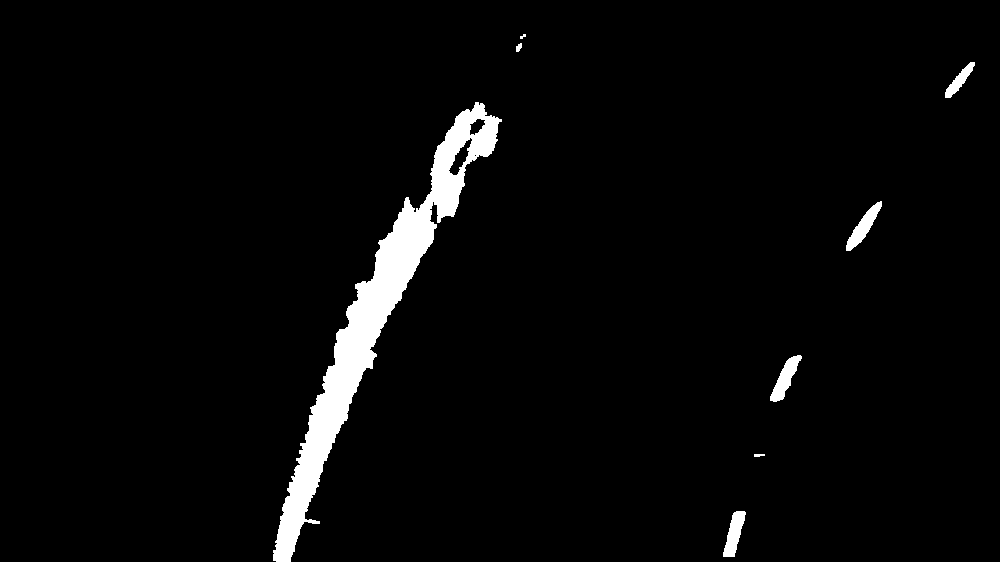
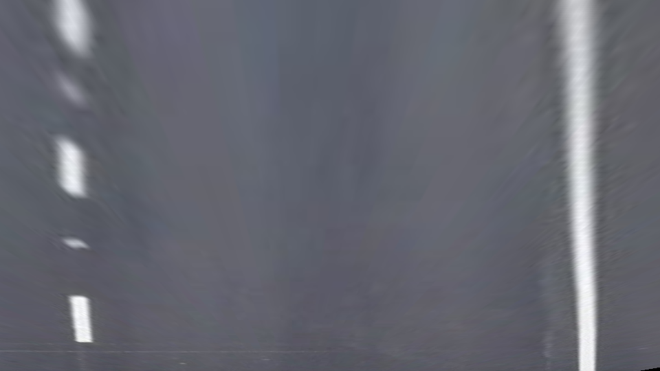
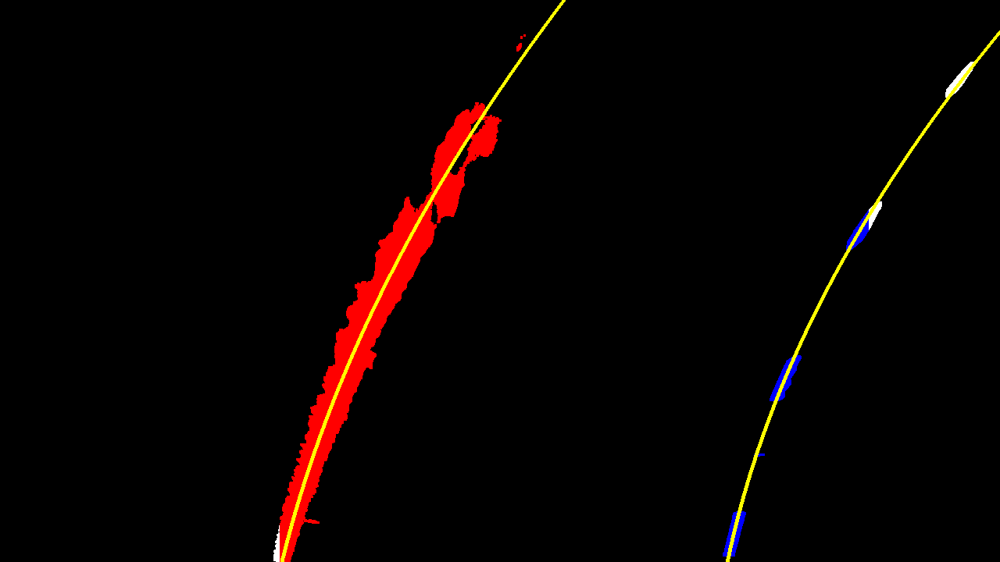
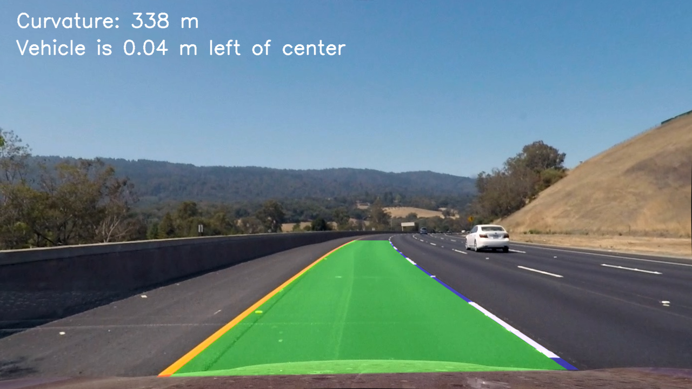

https://github.com/user-attachments/assets/0100387c-8a40-4b43-9ad2-11e7417e529b

## Writeup Template

### You use this file as a template for your writeup.

---

**Lane Finding Project**

The goals / steps of this project are the following:

* Compute the camera calibration matrix and distortion coefficients given a set of chessboard images.
* Apply a distortion correction to raw images.
* Use color transforms, gradients, etc., to create a thresholded binary image.
* Apply a perspective transform to rectify binary image ("birds-eye view").
* Detect lane pixels and fit to find the lane boundary.
* Determine the curvature of the lane and vehicle position with respect to center.
* Warp the detected lane boundaries back onto the original image.
* Output visual display of the lane boundaries and numerical estimation of lane curvature and vehicle position.

[//]: # (Image References)

[image1]: ./examples/undistort_output.png "Undistorted"
[image2]: ./test_images/test1.jpg "Road Transformed"
[image3]: ./examples/binary_combo_example.jpg "Binary Example"
[image4]: ./examples/warped_straight_lines.jpg "Warp Example"
[image5]: ./examples/color_fit_lines.jpg "Fit Visual"
[image6]: ./examples/example_output.jpg "Output"
[video1]: ./project_video.mp4 "Video"

---
### Sources
https://docs.opencv.org/5.0/

https://medium.com/deepvision/udacity-advance-lane-detection-of-the-road-in-autonomous-driving-5faa44ded487

https://nsrishankar.github.io/files/docs/projects/SDND_T1P4_AdvancedLaneDetection.pdf

10th Presentation - 10 Algoritmi u AV.pdf -

### Writeup / README

#### 1. Provide a Writeup that includes all the rubric points and how you addressed each one.

You're reading it!

### Camera Calibration

#### 1. Briefly state how you computed the camera matrix and distortion coefficients. Provide an example of a distortion corrected calibration image.

First I define the ideal board using the rows and columns of inner corners counted on the sample pictures for calibration (9x6), after which I grayscale the image because only intensity is needed. Then I call findChessboardCorners over the image. If the corners were found, I refine their position with cornerSubPix and save them together with the ideal points. After that I calibrate the camera using the ideal and found pairs, which returns mtx for the camera matrix and dist for the distortion coefficients. These are saved to img/calib.npz and later used for undistorting images. The rvecs and tvecs are used for error calculation.

Before undistorting, I compute a new camera matrix with getOptimalNewCameraMatrix. Its alpha parameter decides how the black areas created by undistortion are handled. Alpha = 1 all original pixels are kept and black areas appear at the edges, while with alpha = 0 the image is cropped and scaled so that only valid pixels remain. For the example picture I used alpha = 1, but later in the project I set it to 0, since an image without black edges is easier to work with.

### Pipeline (single images)

#### 1. Provide an example of a distortion-corrected image.

#### 2. Describe how (and identify where in your code) you used color transforms, gradients or other methods to create a thresholded binary image.  Provide an example of a binary image result.

At first I tried to just use Canny on a grayscale picture to segue into Hough detection of lines, but after considering the slides from the 10th presentation I decided to continue with the 2nd method described there, concluding it would be a better option. Considering there were 2 sources of pictures that differ mostly in quality and camera position, I made 2 files that are basically the same and differ only in the use of distortion correction and the transformation matrix. This was done for easier testing and adjustments. pipeline.py is meant for the lower resolution pictures (960x540) and works on the original image, while pipeline2.py is meant for the higher resolution pictures with the front bumper visible (1280x720), and works on the distortion corrected image, since the calibration was done for that camera.
 
The binary image is made in the to_binary() function, which is the same in both files. For the white lines I use the red channel of the image and compare its value with a threshold (R >= 190), since white lines are bright in all channels. For the yellow line I convert the image to HSV and use basic thresholds (H = 15-40, S >= 70, V >= 100). The two masks are combined with OR, and a morphological opening with a 3x3 kernel removes small noise.

#### 3. Describe how (and identify where in your code) you performed a perspective transform and provide an example of a transformed image.

The perspective transform is done in the perspective_matrices() and warp() functions. For this I used the example provided to figure out what points I needed for the task, and using some documentation online as well I experimented and got the values for both types of pictures. The configured points declare a trapezoid on the road which I then map to a rectangle, using getPerspectiveTransform and warpPerspective from the OpenCV documentation, to get a "birds eye view" perspective. The same function also returns the inverse matrix, which is used later to draw the lane back onto the original image. In video.py, perspective_matrices() chooses between the two sets of points based on the width of the frame. The problem I encountered here was configuring the points so that most of the road was visible, but not too much, because the pixels further away were too blurry to discern.

#### 4. Describe how (and identify where in your code) you identified lane-line pixels and fit their positions with a polynomial?

For lane detection I used the slides from the 10th presentation for guidance, along with some internet sources. The input is the warped binary image from the previous step, and the code is in the find_lane_pixels() function in pipeline.py adn pipeline2.py basically doing the same thing, followed by the polynomial fit right after it, also copied into pipeline2.py. First I take a histogram of the bottom half of the binary image by summing the white pixels in each column. The lane lines are almost vertical in the bird’s eye view, so the columns containing them give the highest peaks. I split the histogram at the middle of the image and take the highest peak on each side as the starting x position of the left and right line.

From those positions I use the sliding window method. The image is split vertically into 9 windows, and starting from the bottom, for each window I collect all white pixels within ±100 px of the current line position. If a window contains more than 50 pixels, the next window is centered on their mean x position, so the windows follow the line through curves. If there are fewer pixels, for example in the gaps of a dashed line, the window keeps the same position. Pixels outside the windows are treated as noise and ignored.

After that I fit a second-order polynomial through the collected pixels of each line with np.polyfit:

x = A·y² + B·y + C

The polynomial is a function of y instead of x because the lines are close to vertical, so every y has exactly one x. The fit also connects the gaps between the dashes of the dashed line. Finally I evaluate the polynomial for every row of the image to get the full curve of each line.

For visualization, the pixels of the left line are colored red, the pixels of the right line blue, and the fitted curves are drawn in yellow on top of the binary image.

The main problem here was the choice of window width. If it was too wide, the window picked up noise or the other line, and if it was too narrow, the line left the window in curves.

#### 5. Describe how (and identify where in your code) you calculated the radius of curvature of the lane and the position of the vehicle with respect to center.

Both values are calculated in the curvature_and_offset() function in pipeline.py, using the two polynomials from the previous step.

First I needed to convert pixels to meters. For the x direction I used the fact that a lane is about 3.7 m wide (found online as US standard). I evaluate both polynomials at the bottom of the image, which is the part of the road closest to the car, and divide 3.7 m by the distance between the two lines in pixels. For the y direction I assumed that the visible part of the road in the bird’s eye view is about 30 m long, and divided that by the image height.

With these two ratios I converted the coefficients A and B of each polynomial from pixels to meters as explained in the presentations and concluded from the sample pictures. Then I calculated the radius of curvature using the formula

R = (1 + (2Ay + B)²)^(3/2) / |2A|

evaluated at the bottom of the image. I did this for both lines and used their average as the radius of the lane. On an almost straight road A is very close to zero, so I limited the denominator to a small minimum value to avoid dividing by zero.

For the position of the vehicle I assumed the camera is mounted in the middle of the car, so the center of the car is the center column of the image. The center of the lane is the midpoint between the two lines at the bottom of the image. The difference between these two, multiplied by the meters-per-pixel ratio in x, gives the offset. A positive value means the car is right of the lane center, and a negative value means it is left.

The problem I encountered here was that the left and right radius were sometimes very different. On a straight road both values are huge (thousands of meters), and since the radius depends on 1/A, even a tiny difference between the fits gives a large difference in the result. The dashed line also has fewer pixels than the solid one, especially in the blurry top part of the image, so its fit is less reliable. In the video this is reduced by averaging the fits over the last 5 frames.

#### 6. Provide an example image of your result plotted back down onto the road such that the lane area is identified clearly.

### Pipeline (video)

#### 1. Provide a link to your final video output.  Your pipeline should perform reasonably well on the entire project video (wobbly lines are ok but no catastrophic failures that would cause the car to drive off the road!).

https://github.com/user-attachments/assets/360db04e-a751-4207-9e5e-255c9381b128

### Discussion

#### 1. Briefly discuss any problems / issues you faced in your implementation of this project.  Where will your pipeline likely fail?  What could you do to make it more robust?

The hardest and most fun part of this project was experimenting with the values of the many thresholds and points. There are two types of pictures that both needed a separate matrix for the transformation and slightly different algorithms. The biggest issues, and where the pipeline fails as taught to us, are lighting problems.

The fixed color thresholds lose the lines in shadows and pick up bright concrete as lines, and would likely fail at night or in rain. Worn lines and cars covering them also leave the sliding windows with too few pixels. The perspective transform assumes a flat road, so hills affect the fit, and the blurry top of the warped image makes the radius of curvature the least reliable value. The histogram search also assumes the lines are on each side of the image center, which breaks during lane changes.

To make it more robust I would use adaptive thresholds or add a Sobel gradient, search around the previous fit instead of repeating the sliding windows, and reject fits whose lines are not parallel or about one lane width apart. The video already reuses the last good fit and averages the last 5 frames.
